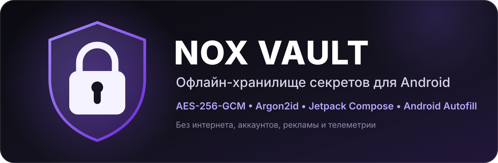
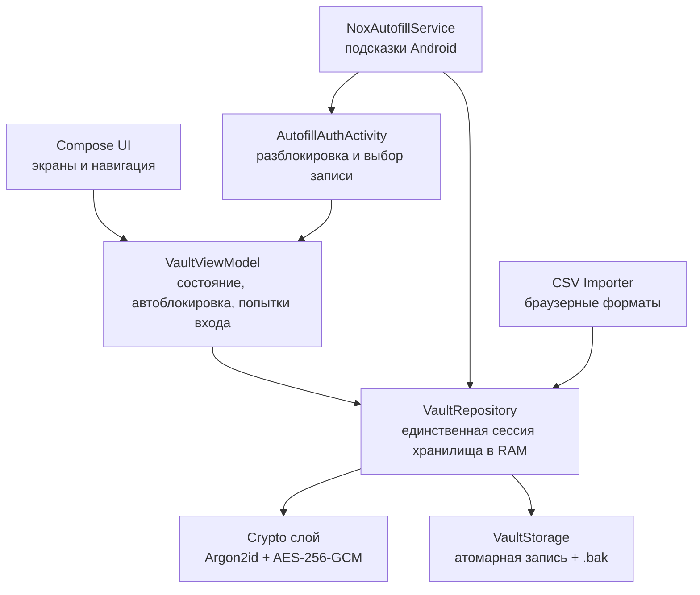

<p align="center">
  
</p>

<p align="center">
  <strong>Локальное зашифрованное хранилище паролей, ключей, заметок и файлов для Android.</strong><br>
  Без сервера, аккаунтов, рекламы, аналитики и даже разрешения <code>INTERNET</code>.
</p>

<p align="center">
  
  
  
  
  
  
</p>

<p align="center">
  <a href="#-возможности">Возможности</a> •
  <a href="#-безопасность">Безопасность</a> •
  <a href="#-технологии">Технологии</a> •
  <a href="#-архитектура">Архитектура</a> •
  <a href="#-сборка-и-запуск">Сборка и запуск</a> •
  <a href="#-тесты">Тесты</a> •
  <a href="#english-summary">English</a>
</p>

> **English:** NOX Vault is an offline Android secret vault written in Kotlin with Jetpack
> Compose. Passwords, API keys, notes and files are stored in one authenticated encrypted
> container (AES-256-GCM with an Argon2id-derived key slot). The app has no Internet
> permission and supports encrypted portable `.nox` backups, browser CSV import and Android
> Autofill. Full documentation below is in Russian.

> [!WARNING]
> Проект не проходил независимый аудит безопасности. Успешные автоматические тесты не
> являются доказательством отсутствия уязвимостей. Перед хранением критически важных
> данных прочитайте [модель безопасности и ограничения](docs/SECURITY.md), сохраните ключ
> восстановления офлайн и проверьте восстановление из резервной копии `.nox`.

## ✨ Возможности

### Хранилище

- 11 категорий: пароли, аккаунты, API-ключи и токены, настройки программ, защищённые
  заметки, файлы и документы, Wi-Fi и сети, серверы, лицензии, резервные коды и «своё».
- Универсальные записи и настраиваемые поля 9 типов: текст, секретный текст, пароль,
  логин, URL, многострочная заметка, дата, число и переключатель.
- Признак «секретное» для каждого поля отдельно.
- Папки, теги, избранное, недавние записи и связи между записями.
- Вложения до 2 МБ, которые хранятся внутри зашифрованного контейнера.
- Поиск, сортировка и фильтры выполняются только в оперативной памяти после
  разблокировки; открытого поискового индекса на диске нет.

### Безопасность и доступ

- Мастер-пароль, независимый ключ восстановления и опциональная разблокировка по
  биометрии.
- Автоблокировка при уходе приложения в фон.
- Растущая пауза после неверных паролей и — только как осознанная опасная опция —
  удаление хранилища после 10 ошибок подряд.
- Защита окна `FLAG_SECURE`: содержимое не попадает в скриншоты и превью недавних
  приложений.
- Автоочистка буфера обмена, если его содержимое не успели заменить другим.

### Резервные копии, импорт и автозаполнение

- Переносимая зашифрованная копия **`.nox`** с отдельным паролем для восстановления
  хранилища на другом устройстве.
- Импорт паролей из CSV от Chrome/Edge и других Chromium-браузеров, Firefox и Safari,
  а также произвольного CSV с ручным назначением столбцов.
- Предпросмотр CSV перед импортом: выбор строк, пропуск дубликатов, папка и теги.
- Служба **Android Autofill**: подставляет логин и пароль в браузеры и приложения.
  Если хранилище закрыто, сначала открывается обычный экран разблокировки.
- Выбор файлов на устройствах, где стандартный DocumentsUI недоступен: приложение
  пробует запасные системные способы, а CSV также можно вставить текстом.

### Интерфейс

- Оригинальная тёмная premium-тема в духе Material 3 и дополнительная светлая тема.
- Полностью русский интерфейс, рассчитанный на пользователя без опыта программирования.
- Генератор паролей на `SecureRandom` отдельным экраном и прямо в форме записи.

## 🔐 Безопасность

NOX Vault не изобретает собственные криптографические алгоритмы.

- Содержимое хранилища сериализуется в единый payload и шифруется случайным
  **32-байтным DataKey** алгоритмом **AES-256-GCM**. Для каждого шифрования используется
  уникальный nonce.
- DataKey не хранится открыто. Он отдельно «завёрнут»:
  - ключом, выведенным из мастер-пароля через **Argon2id** (случайная соль, 64 МиБ,
    `t=3`, `p=1`; параметры и версия KDF хранятся в заголовке контейнера);
  - независимым 256-битным ключом восстановления.
- PBKDF2-HMAC-SHA-256 оставлен как документированный альтернативный KDF, но обычным
  путём создания хранилища является Argon2id.
- Биометрия — дополнительный локальный слот на базе **Android Keystore**. Она не входит
  в переносимый файл `.nox` и не делает хранилище привязанным только к одному телефону:
  мастер-пароль и ключ восстановления продолжают работать без биометрии.
- Названия, теги, заметки, поля и метаданные тоже находятся внутри зашифрованного payload.
- Сохранение атомарное: временный файл → проверка → замена основного; предыдущая
  хорошая версия `.bak` помогает пережить прерванную запись.
- Пароли, ключи и содержимое записей не пишутся в логи и не отправляются по сети.
  У приложения просто нет разрешения `INTERNET`.

Подробно:

- 📄 [Формат контейнера `.nox` и схема ключей](docs/FORMAT.md)
- 🛡️ [Модель угроз, остаточные риски и ограничения](docs/SECURITY.md)
- 🔎 [Политика сообщения об уязвимостях](SECURITY.md)

## 🧰 Технологии

| Область | Что используется |
|---|---|
| Язык | **Kotlin 2.0.21** |
| UI | **Jetpack Compose**, **Material 3**, Navigation Compose |
| Архитектура | **MVVM + Repository**, StateFlow/SharedFlow |
| Асинхронность | Kotlin Coroutines |
| Криптография | Android/JCA AES-256-GCM; **Argon2id** через Bouncy Castle lightweight API 1.78.1 |
| Устройство и доступ | Android Keystore, AndroidX Biometric, Storage Access Framework |
| Автозаполнение | Android Autofill Framework, `AutofillService`, authenticated datasets |
| Сериализация | kotlinx.serialization JSON — только внутри зашифрованного payload |
| Хранение | Один версионированный зашифрованный файл-контейнер; Room/SQLite не используются |
| Сборка | Gradle 8.9 Wrapper, Android Gradle Plugin 8.7.3, JDK 17 |
| Платформа | Android API 35 target/compile; minSdk 26 (Android 8.0+) |
| Тесты | JUnit 4: JVM unit-тесты + инструментальные Android-тесты |

minSdk 26 выбран осознанно: Android 8.0+ даёт современный Keystore, AES-GCM, Autofill
Framework и `java.util.Base64` без дополнительных костылей, при этом покрывает подавляющее
большинство используемых устройств.

## 🏗️ Архитектура



Главный принцип разделения ответственности: интерфейс никогда не работает с файлами
и криптографией напрямую. Все операции проходят через `VaultRepository`; расшифрованные
данные и DataKey живут только в памяти открытой сессии и очищаются при блокировке.

```text
NOXVault/
├─ app/src/main/java/com/noxvault/app/
│  ├─ autofill/       # AutofillService, разбор форм, подбор записи, экран выбора
│  ├─ crypto/         # AES-GCM, Argon2id/PBKDF2, формат контейнера, генератор
│  ├─ data/           # VaultRepository, VaultStorage, импортер CSV
│  ├─ domain/model/   # VaultItem, VaultField, Folder, шаблоны категорий
│  ├─ security/       # Android Keystore/биометрия, буфер обмена, настройки
│  ├─ viewmodel/      # VaultViewModel
│  └─ ui/             # тема, компоненты, экраны, навигация
├─ app/src/test/          # 60 JVM unit-тестов
├─ app/src/androidTest/   # инструментальные тесты репозитория
├─ docs/
│  ├─ FORMAT.md
│  ├─ SECURITY.md
│  └─ assets/
├─ .github/
│  ├─ workflows/android.yml
│  └─ ISSUE_TEMPLATE/
├─ CHANGELOG.md
├─ CONTRIBUTING.md
├─ LICENSE
└─ README.md
```

## 🚀 Сборка и запуск

### Требования

- Android Studio с JDK 17 (JDK встроен в Android Studio);
- Android SDK 35 и Build-Tools 35;
- телефон с Android 8.0+ и включённой USB-отладкой **или** Android Emulator API 35.

### Запуск из Android Studio

1. Скачайте/клонируйте репозиторий и откройте Android Studio.
2. Выберите **Open** и укажите корневую папку проекта — ту, где лежат
   `settings.gradle.kts`, папка `app` и этот README.
3. Нажмите **Trust Project**, если Studio попросит подтверждение.
4. Дождитесь окончания **Gradle Sync**. В первый раз Studio скачает Gradle и библиотеки.
5. Выберите телефон или эмулятор в верхней панели.
6. Нажмите зелёный **Run ▶** (`Shift+F10`).
7. При первом запуске создайте мастер-пароль и запишите ключ восстановления офлайн.

Для подключения физического телефона включите режим разработчика и **Отладку по USB**,
затем разрешите отладку с этого компьютера на самом телефоне.

> [!NOTE]
> В репозитории лежит исходный Android Studio-проект. Готовый APK как отдельный бинарный
> артефакт в Git не коммитится; приложение ставится на устройство кнопкой Run ▶.

### Сборка из терминала

Linux/macOS:

```bash
./gradlew :app:assembleDebug
```

Windows:

```bat
gradlew.bat :app:assembleDebug
```

## 🧪 Тесты

Unit-тесты не требуют телефона:

```bash
./gradlew :app:testDebugUnitTest
```

На Windows:

```bat
gradlew.bat :app:testDebugUnitTest
```

Текущее покрытие — **60 JVM-тестов**: AES-GCM и подмена данных, Argon2id/PBKDF2, полный
цикл контейнера, неверный пароль, ключ восстановления, резервная копия/восстановление,
повреждение файла, генератор паролей, модель данных, браузерный CSV-импорт, порционное
чтение вложений, подбор записей и классификация полей для Android Autofill.

Компиляция инструментальных тестов:

```bash
./gradlew :app:compileDebugAndroidTestKotlin
```

Запуск инструментальных тестов на подключённом устройстве/эмуляторе:

```bash
./gradlew :app:connectedAndroidTest
```

> [!CAUTION]
> Инструментальные тесты работают с реальными файлами приложения на тестовом устройстве
> и удаляют созданное ими хранилище. Не запускайте их на телефоне с настоящим хранилищем
> без свежей, проверенной копии `.nox`.

GitHub Actions при каждом `push` и pull request в `main` запускает unit-тесты и компиляцию
инструментальных тестов: см. [`.github/workflows/android.yml`](.github/workflows/android.yml).

## 📱 Использование

### Первое хранилище

1. Задайте длинный мастер-пароль — лучше фразу из нескольких слов.
2. Запишите показанный ключ восстановления на бумаге и храните отдельно от телефона.
3. Создайте первую запись и сразу сделайте резервную копию `.nox`.
4. Проверьте копию: пароль от `.nox` и сам файл должны храниться в разных местах.

### Включение автозаполнения

1. В NOX Vault: **Настройки → Автозаполнение → «Предлагать логины и пароли»**.
2. Нажмите **«Служба автозаполнения Android»** и выберите NOX Vault в настройках телефона.
3. У записи должны быть заполнены «Логин» и «Пароль»; для сайтов желательно поле
   «Ссылка (URL)», для приложений — понятное название записи.
4. Откройте форму входа и коснитесь поля логина или пароля.

Эта версия автофилла только подставляет существующие записи и пока не сохраняет новые
пароли из чужих форм автоматически.

### Импорт из браузера

Экспортируйте CSV из настроек паролей браузера, перенесите файл на телефон безопасным
способом и откройте в NOX Vault **Настройки → «Импорт паролей из браузера (CSV)»**.

> [!CAUTION]
> Экспортированный браузером CSV содержит пароли в открытом виде. Не пересылайте его
> через мессенджеры и облака; после импорта удалите файл с телефона и компьютера.

## 🗺️ Статус и возможные направления развития

Текущая версия приложения: **1.2.0**. История изменений — в [CHANGELOG.md](CHANGELOG.md).

Возможные следующие шаги (ещё **не реализованы**):

- сохранение новых учётных данных через Android Autofill Save API;
- inline-подсказки автозаполнения над клавиатурой;
- отдельные зашифрованные файлы для больших вложений вместо хранения Base64 в payload;
- независимый аудит криптографического и хранящего кода.

## 🤝 Вклад в проект

Порядок локальной проверки и требования к изменениям описаны в
[CONTRIBUTING.md](CONTRIBUTING.md). Для ошибок и идей в репозитории подготовлены шаблоны
GitHub Issues. Никогда не прикладывайте к issue настоящие файлы хранилища `.nox`,
экспорты паролей CSV, мастер-пароль или ключ восстановления.

## English summary

NOX Vault is a fully offline Android vault for passwords, accounts, API keys, secure
notes, files, Wi-Fi credentials, servers, licences and recovery codes. It is written in
**Kotlin** with **Jetpack Compose / Material 3**, uses **MVVM + Repository**, Coroutines,
Android Keystore/Biometrics, the Storage Access Framework and Android Autofill.

All vault content is serialized into one versioned container encrypted with **AES-256-GCM**.
A random data key is wrapped by an **Argon2id** password slot and by an independent
recovery-key slot. Encrypted `.nox` backups are portable between devices. The app declares
no `INTERNET` permission and contains no accounts, advertising, analytics or telemetry.

Build it with Android Studio (JDK 17, SDK 35) and run `./gradlew :app:testDebugUnitTest`
for the 60 JVM unit tests. The project has not received an independent security audit.

## 📄 Лицензия

Проект распространяется по лицензии **Apache License 2.0**. Полный текст —
в файле [LICENSE](LICENSE).
